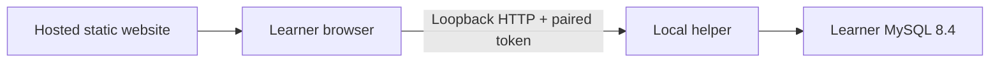

# QueryLab local helper

The preferred architecture is a hosted static website connected to a helper on the learner's computer. The helper runs execution and grading against the learner's MySQL server. Database credentials remain in local configuration; SQL and results travel directly between browser and helper. QueryLab needs no hosted SQL server. This is a working local prototype; public HTTPS-to-localhost browser permissions remain unverified.



## Quick start

Windows learners can now use **Download Windows helper** on the website, extract the ZIP and open **Start-QueryLab-Helper.cmd**. The guided window checks prerequisites and starts the helper before enabling Copy pairing code. Docker Desktop is required; a source checkout and host Node/Python are not. See the [Windows download guide](windows-helper.md). The package is a preview; clean-computer and public HTTPS browser trials remain release requirements.

The following commands remain the developer/source workflow:

Install Docker Desktop with Linux containers. From the repository root in Windows PowerShell:

```powershell
./scripts/start-helper.ps1 -Preview
```

This generates a private, ignored `.env.helper`, starts a bundled practice MySQL server and helper, builds the static preview, and prints the pairing code in your terminal. Open **http://127.0.0.1:8081**, use helper URL **http://127.0.0.1:8765**, and enter that code. Retrieve it later with:

```powershell
./scripts/show-helper-code.ps1
```

For someone unfamiliar with the terminal: open the QueryLab folder in Windows File Explorer (the one containing `compose.helper.yaml`), type `powershell` into the address bar, and press Enter. The startup command generates a private code on first setup and prints `Pairing code for your local helper`, followed by the code. Paste only that code into the website's Pairing code field. If the helper is already running, the show-code command above prints the existing code without restarting it. Leave the prefilled Helper URL unchanged for the default installation.

For a source-based helper used with a separately hosted website, run `./scripts/setup-helper.ps1 -WebsiteOrigin 'https://your-actual-site.example'` before `./scripts/start-helper.ps1`. The website's advanced instructions insert its actual origin into that command. Setup preserves credentials/namespace and adds the chosen exact origin idempotently; the guided Windows launcher performs that setup automatically.

The two addresses serve different purposes: **8081 is the website**; **8765 goes into its Helper URL field**. Opening the helper address directly shows a connection guide with a link to `/api/helper/status`; it does not open the SQL editor.

The helper binds to loopback; the bundled MySQL port is not published. The preview serves static assets without an API proxy. MySQL initialization can take longer than helper startup: Check connection retries database readiness. Healthy helper liveness does not necessarily mean MySQL is ready.

## Use an existing MySQL server

For a new configuration:

```powershell
./scripts/setup-helper.ps1 -Database Existing
# Edit the private .env.helper file locally.
./scripts/start-helper.ps1 -Database Existing -Preview
```

Set `MYSQL_HOST`, `MYSQL_PORT`, `MYSQL_ROOT_USER` and `MYSQL_ROOT_PASSWORD`. Docker Desktop uses `host.docker.internal` to reach MySQL on the host computer; `127.0.0.1` inside the container refers to that container. Ensure MySQL allows the connection. Setup preserves an existing `.env.helper`: edit it deliberately when changing from bundled to existing MySQL. Existing mode starts no bundled database.

Requirements:

- MySQL **8.4.x**; MariaDB, SQL Server and PostgreSQL are unsupported.
- `max_allowed_packet` at most 4 MiB; the bundled configuration uses `4M`.
- `log_bin_trust_function_creators=ON` when binary logging is enabled.
- A local control account able to create/drop practice databases and users, grant practice privileges, inspect those users and cancel their connections. Submitted SQL uses separate schema-scoped credentials.

Compatibility is checked before provisioning or cleanup. The helper never changes global MySQL settings; use a dedicated practice instance if an existing server cannot meet these requirements. SQL mode and UTC timezone are set per connection. A least-privilege control-account setup wizard is future work; bundled MySQL uses its generated local root account.

The persistent random `QUERYLAB_WORKSPACE_NAMESPACE` confines cleanup to complete matching schema/user names, including orphan recovery. Unrelated databases, legacy `ql_` names and other namespaces remain untouched. Do not share the namespace between running helpers. Changing it leaves previous orphan objects for deliberate manual cleanup.

## Pairing, drafts and downloads

Pairing requires the local code and an explicitly trusted website origin. The browser stores a short-lived bearer token in sessionStorage, helper URL and drafts in localStorage, and does not persist the pairing code. Tokens are accessible to website JavaScript: deploy trusted frontend code. There is no HTTP database-credential configuration endpoint.

Use Connection in the header to disconnect or re-pair. Helper restart/token expiry retains drafts but requires pairing again; the new workspace must finish preparation before Run/Submit becomes available. The default idle lifetime is one hour. Reset restores fixtures and removes learner routines while preserving drafts. Pairing is limited to eight attempts per minute/client address.

**Download dataset SQL** exports public practice DDL/seeds for an external MySQL client. It creates `querylab_online_store_v1` or `querylab_inventory_v1`; existing names cause an error rather than an overwrite. No drops, user creation, grants, answers or hidden test variants are exported. Do not paste installation SQL into QueryLab's Run editor, which intentionally lacks database-creation privileges and has smaller script limits.

Helper-managed practice/grading fixtures are created automatically and are independent of downloaded databases. External-client queries are graded only when pasted into the website and submitted. The computer's owner can inspect local grading assets: this is learning feedback, not exam integrity.

## Host the website separately

```powershell
cd frontend
npm ci
npm run build:helper
```

Deploy `frontend/dist/` as static files with SPA fallback to `index.html`. Add the deployed website's exact HTTPS origin, without path/trailing slash, to comma-separated `QUERYLAB_HELPER_ALLOWED_ORIGINS` in `.env.helper`, then recreate the helper. New configurations can supply `setup-helper.ps1 -WebsiteOrigin https://your-domain.example` (example only).

Browser local-network permissions and HTTPS-to-loopback behavior vary. Explicit CORS/private-network preflight, loopback Host checks and bearer authentication are implemented. A real public HTTPS origin, permission denial/recovery and Chrome/Edge/Firefox/Safari verification remain release checks. Local HTTP preview success does not prove this deployment path.

Developers with Python 3.12 can alternatively install `backend/requirements.txt` in a virtual environment and run from `backend/`:

```powershell
python -m uvicorn app.main:app --env-file ../.env.helper --host 127.0.0.1 --port 8765 --workers 1
```

Set a host-reachable MySQL address and `QUERYLAB_HELPER_MODE=true`. This native path is supplied for developers; verification used Docker, not host Python. Use one worker because sessions/jobs are process-local.

## Stop and verify

```powershell
docker compose --env-file .env.helper -f compose.helper.yaml --profile bundled --profile preview stop
```

Stopping retains storage/configuration. See [validation](helper-validation.md), [QA evidence](helper-qa.md) and [security review](helper-security-review.md). Accounts/statistics remain deferred. All twelve challenges are executable and the Windows helper is packaged. The current download is v0.4.1, including optional newline-separated SELECT/WITH batches and clearer misplaced-semicolon errors. Public static deployment, installation trials and browser certification remain release work.
